# Mandelscope

**Dive into the Mandelbrot set, as deep as you like.** Mandelscope is a GPU explorer that computes every frame live on your graphics card. It zooms smoothly to magnifications of 10^1000 and beyond (tested to 10^3000), into Julia sets and the Burning Ship too, renders exact, supersampled stills and videos, and fits in a Python package you can read.

| From the seahorse valley to 10^12 | From the whole set to 10^100 |
|:-:|:-:|
| 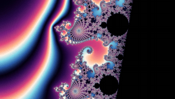 | 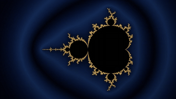 |

| | | |
|:-:|:-:|:-:|
| 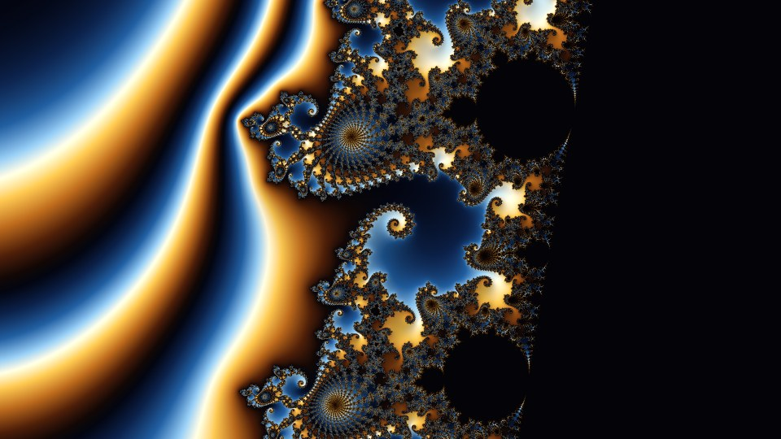 | 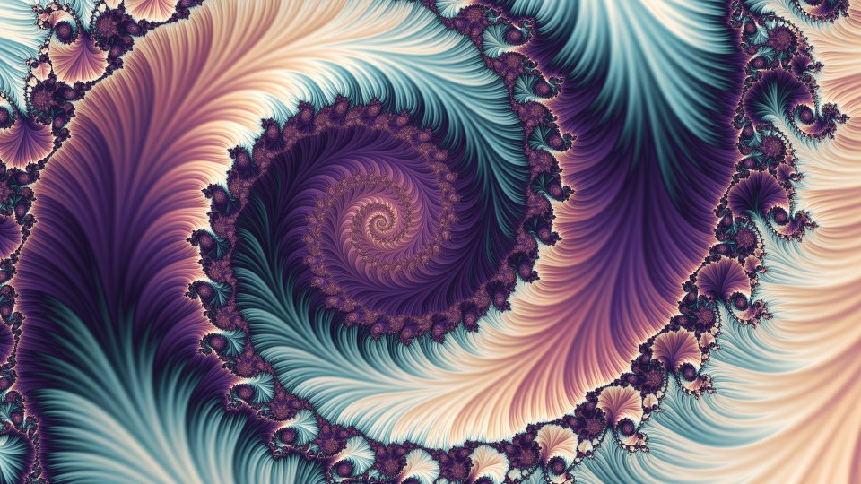 | 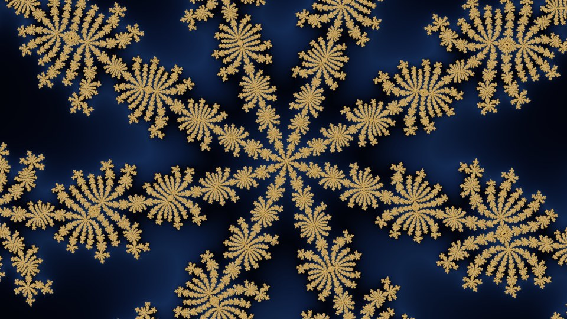 |
| Seahorse valley · *Gilded* | Double spiral · *Silk* | Starfish · *Midnight* |
| 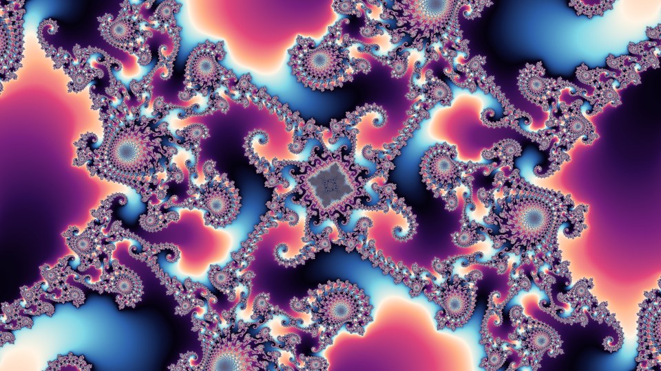 | 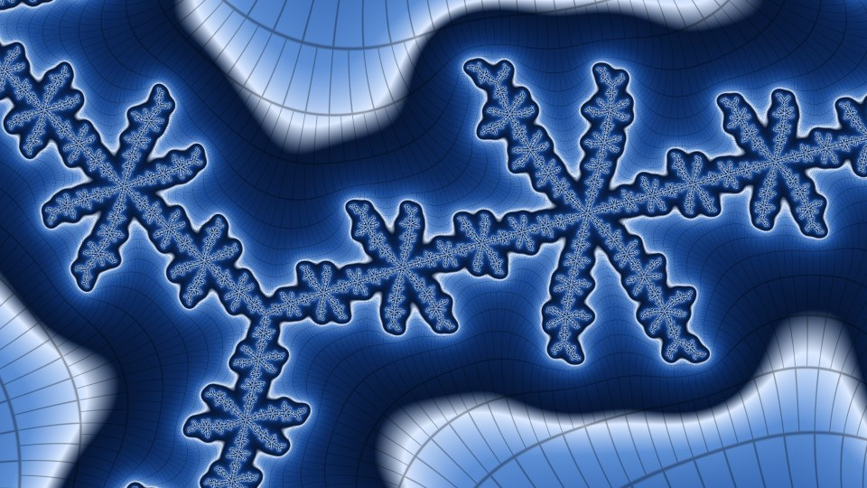 | 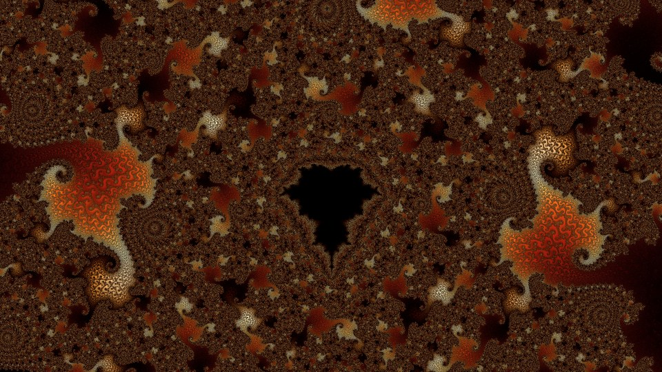 |
| 10^12 · *Nebula* | 10^100 · *Blueprint* | minibrot, period 6006 · *Ember* |
| 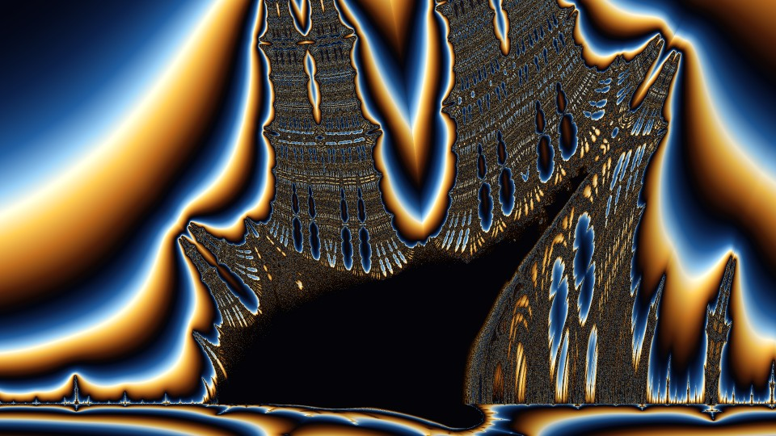 | 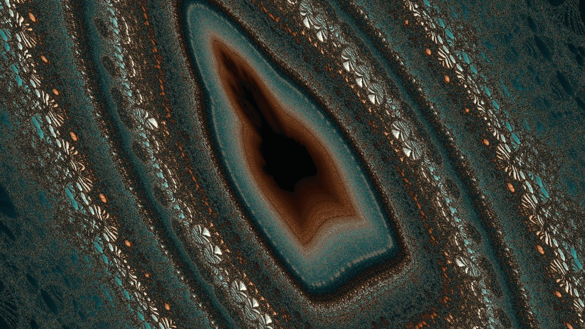 | 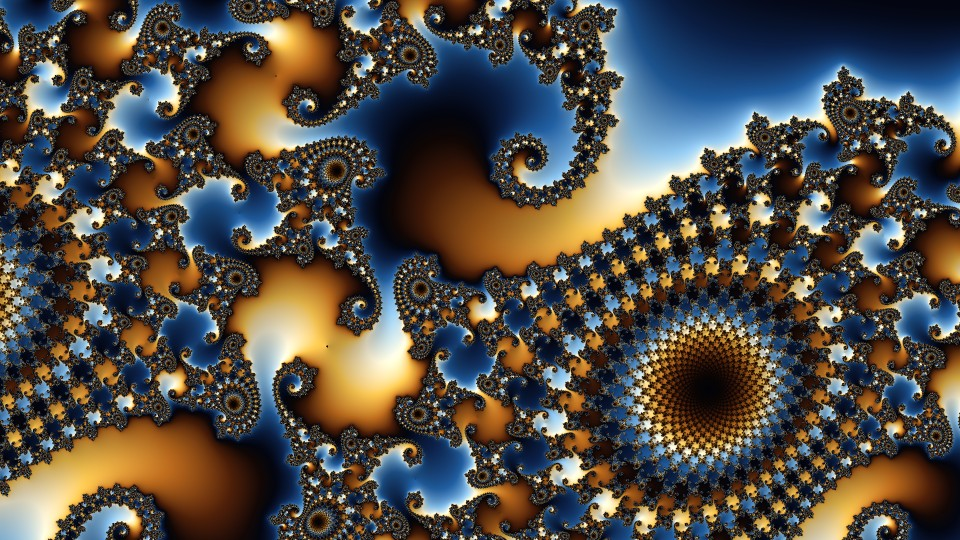 |
| Burning Ship, the armada · *Gilded* | mini ship at 10^33 · *Copper* | Julia set of c = −0.7445 + 0.1123i · *Gilded* |

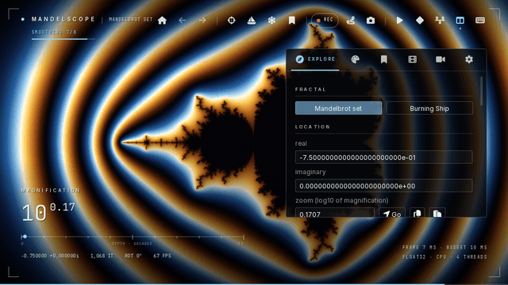

## Features

- **Deep zoom in real time.** The engine combines perturbation theory, rebasing and second-order bilinear approximation, with rescaled floats on OpenGL compute shaders. It needs no glitch correction and no series approximation, and goes to any depth.
- **Smooth to fly.**
  - Spring-damped wheel zoom, gliding pans and rotation.
  - 2× and 4× zooms reuse the samples already computed.
  - Camera steps are paced to your display, and the GPU work per frame stays within its budget.
  - Heavy places drop to half resolution while zooming and sharpen when you stop.
- **Automatic iterations.** The limit is raised only when that reveals detail, and lowered again when the extra iterations change nothing.
- **17 colour looks** with live previews, a gradient editor and random palettes. Colouring options include distance estimation, 3-D lighting, stripe textures and field lines.
- **Julia sets.** A live preview of the Julia set of the point under the cursor, and full exploration of any one of them, to any depth.
- **The Burning Ship** (key **B**), with the same deep-zoom engine, a mini-ship finder and its own famous places.
- **Library** of famous places and your own saved locations, plus a **minibrot finder**.
- **Videos.**
  - A keyframe timeline and a small script language for camera paths. *Copy AI prompt* helps an assistant write them for you.
  - Export up to 8K with NVENC, AMF, QSV or x264.
  - Fast zoom movies share computed pictures between frames.
- **Game controllers.** PlayStation, Xbox, Switch Pro and other pads: fly with the sticks, zoom with the triggers.
- **CPU mode** for computers without a suitable graphics card. The same engine runs on the processor through Mesa's software OpenGL; it's slower, but every feature works.
- Two interface styles: the **Cinematic HUD** (shown above) and **Classic**.

## Install

### Windows, ready to run
Download `Mandelscope-<version>-windows-x64.zip` from the [Releases](../../releases) page, unzip it anywhere and start `Mandelscope.exe`. Python is not needed.

### Windows, from source
Download or clone this repository and double-click **`Install Mandelscope.bat`**. The first run takes a few minutes. It installs [uv](https://docs.astral.sh/uv/), a private Python 3.12 and the dependencies into `.venv`, and creates **Mandelscope** shortcuts on the Desktop and in the Start menu.

- `run.bat` starts the explorer with a console window, which is handy for the command-line tools.
- `Build Mandelscope.exe.bat` builds the stand-alone `dist\Mandelscope\` folder.

### Linux (or any platform with uv)
```
uv sync
uv run python -m mandelscope            # explorer
uv run python -m mandelscope info       # GPU and video encoder check
```

**Requirements:** a graphics card with OpenGL 4.3 (any NVIDIA, AMD or Intel GPU from the last ten years), or any 64-bit processor in CPU mode. Python 3.10–3.13 when running from source. ffmpeg comes with `imageio-ffmpeg`. macOS is not supported, because it stops at OpenGL 4.1.

### No graphics card? CPU mode
Mandelscope can run its engine on the processor with [Mesa](https://www.mesa3d.org/)'s llvmpipe, a software OpenGL 4.5 driver that compiles the shaders for your CPU's vector units and uses every core. Pictures are identical, just slower. Two cores of a cloud machine take 0.4 s for the whole set at 1280×720 and 5.5 s for the seahorse spiral at 10^12 (20,000 iterations), 60–330× longer per pixel than an RTX 5060 Ti; a desktop processor with 8 cores is several times faster than that. To keep it responsive, CPU mode zooms at down to a quarter of the resolution, does fewer smoothing passes and stops redrawing when nothing changes.

- **Windows:** when the graphics driver has no OpenGL 4.3, Mandelscope switches to CPU mode by itself. The release zip has Mesa in its `software` folder; from source it offers to download it (some tens of MB, from [mmozeiko/build-mesa](https://github.com/mmozeiko/build-mesa)). You can also choose CPU mode yourself: `Mandelscope.exe --software`, `run.bat --software`, or *Render → Renderer → restart in CPU mode*.
- **Linux:** Mesa is part of the system, so `./run.sh --software` is enough. Machines without a GPU driver use llvmpipe automatically.

## Using it

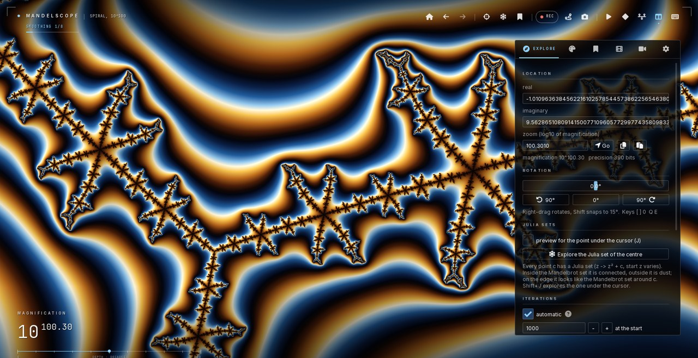

The first start shows the basic controls. **F1** lists every key and controller button at any time.

| Mouse | |
|---|---|
| wheel | zoom at the cursor (Ctrl: fine, Shift: rotate) |
| left drag | pan (glides when released) |
| right drag | rotate (Shift snaps to 15°) |
| double-click / middle click | zoom ×4 into that point / centre it |
| right click | menu: find minibrot, Julia set, keyframe, save … |

| Keyboard | |
|---|---|
| **+ / −** (PgUp / PgDn) | zoom at the centre: tap = 2×, hold = continuous |
| **Z / X** | zoom at the cursor: tap = 2×, hold = continuous |
| Shift / Ctrl | faster / finer |
| arrows or **W A S D**, **Q / E** | pan, rotate |
| **[ / ]**, **0** | rotate 90°, rotation back to 0° |
| **H**, **Backspace** (Shift: forward) | home, back |
| **M** | find the minibrot (or mini ship) under the cursor |
| **B** | the Burning Ship / back to the Mandelbrot set |
| **J** / **Shift+J** | Julia set preview / explore the Julia set under the cursor (J again: back) |
| **K**, **Space**, **T** | add keyframe, play/pause, show/hide the timeline |
| **R**, **P** | live screen recording, record your flight as a timeline |
| **F12** | screenshot (2× supersampled PNG with the location embedded) |
| Ctrl+C / Ctrl+V | copy / paste the location |
| **Tab**, **F1** | hide all panels, help |

| Controller (PlayStation names; Xbox: A B X Y, LB RB LT RT) | |
|---|---|
| left stick | move |
| **R2 / L2** | zoom in / out (press harder to go faster) |
| right stick | up/down: zoom, left/right: turn |
| R1 / L1 (hold) | faster / finer |
| cross / circle | find the minibrot at the centre / back |
| square / triangle | Julia set preview of the centre / add a keyframe |
| D-pad ← → / ↑ ↓ | previous / next look, more / fewer iterations |
| L3 / R3 | home / rotation back to 0° |
| options / create / PS | hide the panels / screenshot / help |

Controllers work over USB or Bluetooth. Speed, dead zone and zoom direction are under *Explore → Controller*.

The side panel has six tabs:
- **Explore**: exact coordinates (paste any number of digits), rotation, iterations, navigation.
- **Look** (called *Colour* in the classic style): live previews of every look, palettes, the gradient editor and all colouring options.
- **Library**: famous places and your saved ones. Right-click a thumbnail to fly there or make a zoom movie to it.
- **Animate**: keyframes, *zoom movie into this view*, flight recording and the script editor.
- **Export**: video and still settings (including up to 256× more iterations than the explorer), and a render queue.
- **Render**: interface style, quality and precision (float32; precise: float64 or float-float), statistics.

Your files go to `Documents\Mandelscope Files`: `Locations`, `Videos`, `Images` and `Scripts`.

### Scripts
```
fps 60
look Nebula
start home
zoom to location "seahorse_valley" over 12s ease smooth
zoom in 1e6 over 20s spin 1
hold 2s
zoom out 1e6 over 10s
```
*Apply* turns a script into keyframes, and *From timeline* writes the current timeline as a script. The full reference is under the **?** button in the Animate tab.

## Command line

```
run.bat render mandelscope\locations\deep_1e-1000.json -o deep.png --size 3840x2160 --ss 2 --look Silk
run.bat render mandelscope\locations\minibrot_p6006.json -o mini.png --iter-mult 16 --ff   # 16x the iterations, precise
run.bat video  my_movie.seq.json -o zoom.mp4 --size 1920x1080 --fps 60 --ss 2 --codec hevc_nvenc
run.bat bench                     # speed test on your GPU
run.bat bench --f64               # ... also the precise modes (float64, float-float)
run.bat bench --experiments --bla # A/B tests of engine options, deep-render variants
run.bat gui --motion-study        # the explorer drives itself; records frames and per-frame metrics
run.bat info
run.bat --software                # the explorer in CPU mode (works with every command)
run.bat get-mesa                  # Windows: install Mesa's software OpenGL for CPU mode
```
On Linux, use `./run.sh` or `uv run python -m mandelscope` instead of `run.bat`.

## How it works

| Technique | Effect |
|---|---|
| **Perturbation**: one MPFR reference orbit (gmpy2, in a worker process); every pixel iterates a small delta on the GPU | arbitrary depth at GPU speed |
| **Rebasing** (Zhuoran) | no glitches, one reference per picture |
| **Second-order bilinear approximation**: a table of `z → A z + B c + C z² + D z c + E c²` skips | skips most iterations at depth; 3–4× fewer steps than first order near deep minibrots |
| **Rescaled floats** (mantissa + exponent) | float32 works far below 10^-38; so do the precise modes, float64 and float-float (two float32 per number, fast on gaming GPUs) |
| **Julia sets**: a reference orbit at the view's point and the orbit of 0, rebasing from one to the other | Julia sets at any depth |
| **The Burning Ship**: perturbation through the absolute values (diffabs), the exact product XY with every reference value | glitch-free, also next to the needle |
| **Progressive, resumable work** with a per-frame time budget | responsive at any iteration count; never trips the GPU watchdog |
| **Sample reuse**: pans shift computed samples; 2×/4× zooms keep the coinciding ones; raising the iteration limit continues only unfinished samples | instant pans, incremental refinement |
| **Consistent display**: finished samples are shown once their neighbours are done; coarse levels are interpolated with Catmull-Rom | no dot grids while a picture refines |
| **Frame pacing**: camera steps follow the display interval | even motion on an even display |
| **Fast zoom movies**: key pictures shared by many frames, with ≥ ss×ss samples per pixel and colours per frame | ≈ 5–15× fewer samples for zoom movies |

The full story, with the measurements behind each decision, is in [`docs/design-notes.md`](docs/design-notes.md).

## Troubleshooting

- **"Mandelscope could not start" / OpenGL 4.3.** Update the graphics driver. On laptops, make sure the program runs on the discrete GPU. Without a suitable GPU, use CPU mode (see *No graphics card?*).
- **The controller does nothing.** Check *Explore → Controller*: it shows the connected pad, or why it isn't used. A pad that isn't recognised needs a newer mapping: put [`gamecontrollerdb.txt`](https://github.com/mdqinc/SDL_GameControllerDB) into `%APPDATA%\mandelscope` and restart. Steam's controller settings or DS4Windows can also make a PlayStation pad look like an Xbox one, which always works.
- **Only x264 in the codec list.** NVENC needs a recent NVIDIA driver. `run.bat info` shows which encoders work.
- **Very deep zooms start slowly.** The reference orbit is computed on the CPU (the status shows its progress). The picture appears after half a second with the part of the orbit computed so far ("iterations" in the status) and continues when the rest arrives; the reference is reused while you keep zooming into the same area.
- **Where things are:**
  - settings: `%APPDATA%\mandelscope` (`settings_cpu.json` in CPU mode);
  - Mesa for CPU mode, when downloaded: `%LOCALAPPDATA%\mandelscope\mesa`;
  - log: `%LOCALAPPDATA%\mandelscope\mandelscope.log`;
  - your files: `Documents\Mandelscope Files`.

## Contributing

Bug reports, benchmark results from your GPU, looks, places and code are welcome. See [CONTRIBUTING.md](CONTRIBUTING.md). Run the test suite with `uv run pytest -q`. The animations and pictures at the top of this page are made by `tools/readme_media.py` and `tools/readme_tour.py`. It runs without a graphics card too, using Mesa's software OpenGL; that's what the GitHub CI uses.

## Licence and credits

MIT (see [LICENSE](LICENSE)). The bundled fonts and the Mesa files of the CPU mode have their own licences, listed in [THIRD_PARTY_NOTICES.md](THIRD_PARTY_NOTICES.md).

Mandelscope stands on ideas the fractal community worked out in the open:
- perturbation: K. I. Martin;
- rebasing and bilinear approximation: Zhuoran;
- rescaling, BLA refinements and much of the deep-zoom theory: Claude Heiland-Allen, in Kalles Fraktaler and Fraktaler 3;
- the many contributors at fractalforums.org.

[CREDITS.md](CREDITS.md) lists every technique Mandelscope follows, where it comes from, and the projects we studied. Mandelscope's code is an independent implementation: no code was copied from those projects.
